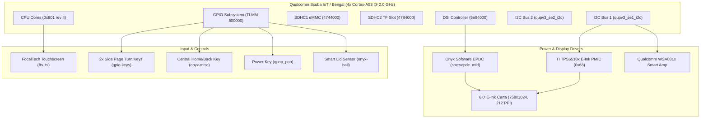
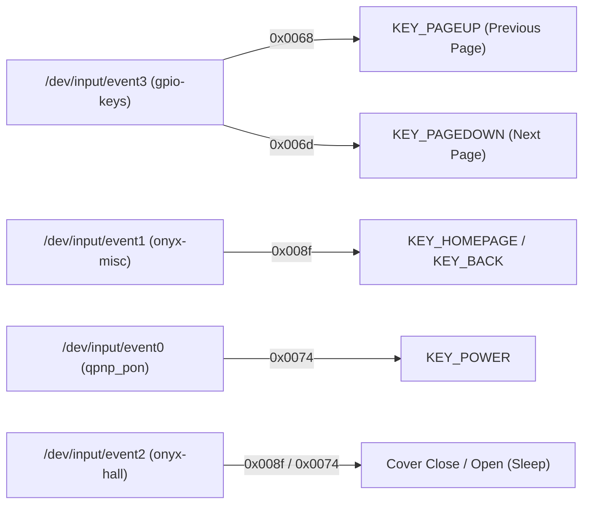

# TWRP Device Tree for Onyx Boox C69 (`C69_M_STAR`)

An open-source TeamWin Recovery Project (TWRP 11.0) device tree for the unbranded **Onyx Boox C69** platform (commercial twin: **Onyx Boox Faust 5** / classic Onyx C-Series 6.0" chassis).

[](https://github.com/7sarus/android_device_onyx_c69/actions/workflows/twrp.yml)

> [!IMPORTANT]
> **Zero-Risk Testing via Unlocked Bootloader**:
> The bootloader on this device is **unlocked** (`unlocked:yes`, `critical unlocked: true`). Never flash custom recovery to internal storage directly. Always test custom builds in memory:
> ```bash
> fastboot boot recovery.img
> ```

> [!NOTE]
> **Pure Ambient Display (Zero LEDs)**:
> This specific white-label hardware variant completely omits both the frontlight LED guide layer and status LEDs. The E-Ink Carta panel relies entirely on ambient reflective light, providing higher contrast and cleaner white levels than frontlit screens.

> [!WARNING]
> **No Warranty**:
> This device tree and compiled builds come with **absolutely no warranty**. Use entirely at your own risk. You are welcome to test, submit pull requests, and report issues/logs on [GitHub Issues](https://github.com/7sarus/android_device_onyx_c69/issues).

---

## Current Status

| Feature | Status | Notes |
| :--- | :--- | :--- |
| **Build & CI** | Working | Compiles cleanly via GitHub Actions & minimal manifest |
| **Kernel Boot** | Working | Boots successfully into RAM (`fastboot boot recovery.img`) |
| **USB / ADB** | Working | Enumerates as recovery device; ADB shell accessible |
| **E-Ink Display** | Broken | Shows two black bars; DRM / EPDC framebuffer not drawing TWRP GUI |
| **Touch / UI** | Blocked | Digitizer and UI interaction blocked by display output failure |

### What Works
- GitHub Actions CI workflow builds without errors.
- Device boots the recovery image via fastboot tether boot.
- USB gadget initializes and ADB daemon responds in recovery mode.

### What Doesn't Work / Untested
- **Display Output**: E-Ink screen only displays two black bars instead of the TWRP touch interface.
- **UI Interaction**: Touch and key handling cannot be used without display output.
- **Storage & Decryption**: Partition mounting and `/data` decryption are untested pending screen fix.

---

## Hardware Architecture



---

## Detailed Hardware Specifications

| Component | Specification | Live Verified Source |
| :--- | :--- | :--- |
| **Model / ODM** | `C69_M_STAR` | `ro.product.model = C69_M_STAR` |
| **Commercial Twin** | Onyx Boox Faust 5 | Same chassis, buttons, SoC, and resolution |
| **SoC Platform** | Qualcomm Scuba IoT (`SCUBAPIIOT`) | Platform `bengal`, variant `QCS EMMC` (`001860e1`) |
| **CPU Architecture** | 4× ARM Cortex-A53 @ 2.0 GHz | 64-bit kernel, `arm64-v8a` ABI (Part `0x801`) |
| **RAM** | 2 GB LPDDR4X | `MemTotal: 1817196 kB` |
| **Internal Storage** | 16 GB eMMC | `/dev/block/mmcblk0` (`MMC16G`, Micron/Spectek) |
| **MicroSD Expansion** | TF Slot (Dedicated SDHCI) | `/dev/block/mmcblk1p1` (`sdhci@4784000`) |
| **Display Panel** | 6.0" E-Ink Carta | 758 × 1024 pixels (212 PPI, 4:3 aspect ratio) |
| **E-Ink Display PMIC** | Texas Instruments **TPS6518x** | I2C1 @ `0x68` (VPOS +15V, VNEG -15V, VEE -20V, VDD +22V) |
| **Audio Amplifier** | Qualcomm **WSA881x** | Smart speaker amplifier (`wsa881x-i2c-codec`) |
| **Touchscreen Digitizer** | FocalTech `fts_ts` | 1448 × 1072 digitized surface grid |
| **Front Light / LEDs** | **None** | Completely unpopulated (pure ambient reflective) |
| **Kernel Version** | Linux `4.19.157-perf` | Stock prebuilt kernel included in tree |

---

## Physical Controls & Keycode Mappings



| Event Node | Driver Name | Linux Keycode | Action / TWRP Function |
| :--- | :--- | :--- | :--- |
| `/dev/input/event3` | `gpio-keys` | `0x0068` (104) | Page Up (Menu Up) |
| `/dev/input/event3` | `gpio-keys` | `0x006d` (109) | Page Down (Menu Down) |
| `/dev/input/event1` | `onyx-misc` | `0x008f` (143) | Home / Back Button |
| `/dev/input/event0` | `qpnp_pon` | `0x0074` (116) | Power Button (Select / Screen Off) |
| `/dev/input/event2` | `onyx-hall` | `0x0038`, `0x008f` | Magnetic Folio Cover Sensor |
| `/dev/input/event4` | `fts_ts` | Multi-touch | Capacitive Touch Digitizer |

---

## Partition & Mount Layout

The device uses an A/B dual-slot layout with a 4 GB dynamic `super` container:

| Mount Point | Block Device | Filesystem | Flags / Description |
| :--- | :--- | :--- | :--- |
| `/system` | `system` (in `super`) | ext4 | Logical dynamic partition (A/B) |
| `/system_ext`| `system_ext` (in `super`) | ext4 | Logical dynamic partition (A/B) |
| `/vendor` | `vendor` (in `super`) | ext4 | Logical dynamic partition (A/B) |
| `/product` | `product` (in `super`) | ext4 | Logical dynamic partition (A/B) |
| `/data` | `/dev/block/bootdevice/by-name/userdata` | f2fs | ~8.9 GB user storage (`encryptable=footer`) |
| `/metadata`| `/dev/block/bootdevice/by-name/metadata` | ext4 | Wrapped key metadata storage |
| `/sdcard` | `/dev/block/mmcblk1p1` | vfat | External MicroSD / TF card |
| `/boot` | `/dev/block/bootdevice/by-name/boot` | emmc | 96 MB kernel + base DTB |
| `/misc` | `/dev/block/bootdevice/by-name/misc` | emmc | 1 MB BCB commands |

---

## How to Build

### Option A: Automated GitHub Actions (Recommended)
1. Fork or push this repository to GitHub.
2. Navigate to **Actions > Build TWRP Recovery for Onyx Boox C69**.
3. Click **Run workflow**.
4. Download the compiled `twrp-c69-recovery` artifact containing `recovery.img`.

### Option B: Local Compilation

```bash
# 1. Initialize minimal TWRP-11 manifest
mkdir -p ~/twrp && cd ~/twrp
repo init -u https://github.com/minimal-manifest-twrp/platform_manifest_twrp_aosp.git -b twrp-11 --depth=1
repo sync -c -j$(nproc --all) --force-sync --no-clone-bundle --no-tags

# 2. Clone this device tree
git clone https://github.com/7sarus/android_device_onyx_c69.git device/onyx/c69

# 3. Build recovery image
source build/envsetup.sh
export ALLOW_MISSING_DEPENDENCIES=true
lunch twrp_c69-eng
mka recoveryimage -j$(nproc --all)
```

---

## Testing & Installation

### Step 1: Tether-boot in RAM (Zero Risk)
```bash
adb reboot bootloader
fastboot boot recovery.img
```

### Step 2: Flash Permanently (Only after verified working)
```bash
fastboot flash recovery_a recovery.img
fastboot flash recovery_b recovery.img
```
